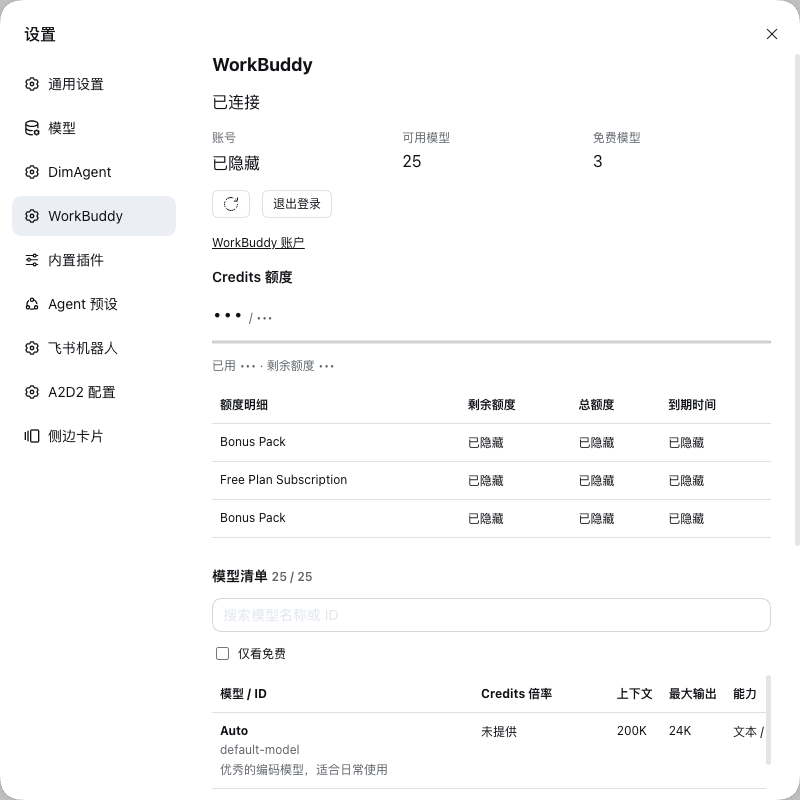
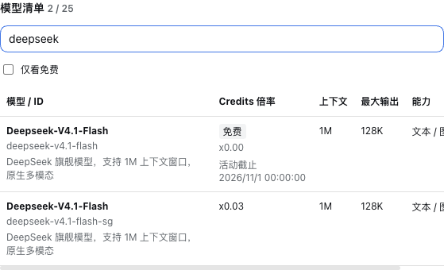
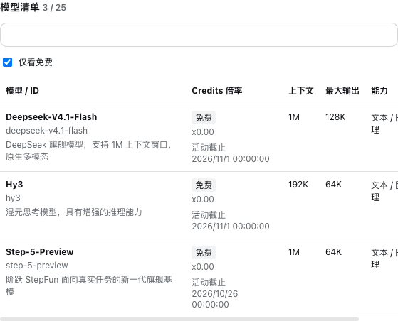

# DSH WorkBuddy

[English](README.md) | [简体中文](README.zh-CN.md)

为 DeepSeek Harness（DSH）提供 WorkBuddy 账号登录和模型调用的独立插件。在「设置 → WorkBuddy」中完成浏览器授权，查看账号状态、Credits 余额、额度到期明细，以及支持搜索和免费筛选的模型清单。模型选择器会展示 WorkBuddy 模型，通过模型 ID 区分同名入口，并标记明确免费的模型。

本插件独立于 A2D2 和 DimAgent 插件。模型请求复用 DSH 的 `PiAiAdapter`，单独运行的 Python 服务引用 [workbuddy2api](https://github.com/Zhengyuuuui/workbuddy2api)，处理流式响应和工具调用协议转换。授权凭据保存在服务端，浏览器只接收授权链接和账号状态；完成授权后，无需持续运行 WorkBuddy 桌面客户端。

## 界面截图

截图中的账号、实际额度和额度到期时间均已脱敏。模型可用性、倍率和免费活动以账号实时返回的数据为准，截图不代表长期定价承诺。

### 账号与 Credits 额度

查看连接状态、可用模型数、免费模型数，以及各额度包的余额和到期时间。



### 搜索模型

支持按名称或 ID 搜索。同名模型保留不同的 ID，并分别展示 Credits 倍率、上下文、最大输出和能力。



### 免费模型筛选

勾选「仅看免费」筛选当前明确免费的模型。免费状态来自上游计费字段和有效期内的活动；未知价格不会被当作免费。



## 安装

需要兼容的 DSH 环境；Node.js 版本要求为 `^22.19.0 || >=24.0.0`。在插件目录执行：

```sh
pnpm install --frozen-lockfile
pnpm build
dsh plugin --profile web add /absolute/path/to/dsh-workbuddy
```

在该 profile 的 `cordis.patch.yml` 中配置：

```yaml
- id: workbuddy
  config:
    gatewayBaseURL: https://workbuddy-gateway.example.com
    gatewayKeyFile: /absolute/path/to/workbuddy-gateway-key
    requestTimeoutMs: 30000
    catalogTtlMs: 60000
    streamIdleTimeoutMs: 300000
```

以上域名和路径是示例，需替换为自己的部署配置。密钥文件只包含网关的 Bearer 凭据，不要写成环境变量赋值语句。不要把 WorkBuddy 授权 Token 写入 DSH 配置或提交到仓库。网关必须启用鉴权，Python 服务应只监听回环地址，并由网关转发。

## 服务部署

已验证的上游版本为 `1cc32c9a98abb53796d8d4e8d477736fe1f0c4cc`。单独检出上游项目并切换到该版本，使用 `uv sync` 安装依赖，再通过其虚拟环境运行本插件的服务入口：

```sh
/absolute/path/to/workbuddy2api/.venv/bin/uvicorn \
  --app-dir /absolute/path/to/dsh-workbuddy/server \
  workbuddy_service:create_app --factory \
  --host 127.0.0.1 --port 18788
```

通过 Supervisor 等服务管理器配置以下环境变量：

| 变量 | 用途 |
| --- | --- |
| `WORKBUDDY_PROXY_SOURCE` | 固定版本的上游项目目录 |
| `WORKBUDDY_ENDPOINT` | WorkBuddy 后端地址，通常为 `https://www.workbuddy.ai` |
| `WORKBUDDY_SESSION_FILE` | 私有、可写的凭据文件路径，也可读取已有代理会话 |
| `WORKBUDDY_LOGIN_TTL_SECONDS` | 授权流程有效时间，单位秒，通常为 `300` |
| `WORKBUDDY_LOG_FILE` | 协议摘要日志路径 |

使用单个服务 worker 管理账号及待完成的登录流程。Token 刷新采用串行处理，凭据通过原子替换写入。退出登录会移除本服务保存的授权，不会撤销其他设备。授权链接过期后，可在设置中重新发起登录。网关访问密钥与 WorkBuddy 账号授权是两套独立凭据。

更多部署示例见 [部署指南](deploy/README.md) 和 [Supervisor 配置示例](deploy/workbuddy2api.conf)。部署更新后，应重新加载已有浏览器标签页，确认插件前端已更新。

## 验证

```sh
pnpm test
pnpm typecheck
pnpm build
```

Python 测试需使用已安装上游依赖的虚拟环境，并将上游及本插件的 `server` 目录加入 `PYTHONPATH`：

```sh
PYTHONPATH=/absolute/path/to/workbuddy2api/server:/absolute/path/to/dsh-workbuddy/server \
  /absolute/path/to/workbuddy2api/.venv/bin/pytest \
  server/test_session.py server/test_pricing.py
```

实际验收还需检查 DSH 设置页、账号授权、流式文本，以及完整的工具调用与结果回传。上游目前有一条过时的客户端请求头断言；本插件没有修改或屏蔽该断言。

## 卸载

通过 DSH 插件管理器移除此插件，并停止对应的独立服务。现有 DSH provider 和会话不受影响。如果卸载前未退出登录，磁盘上的 WorkBuddy 凭据会保留。

## 许可证

本项目采用 [Apache License 2.0](LICENSE)。单独安装的上游项目保留其自身许可证。
